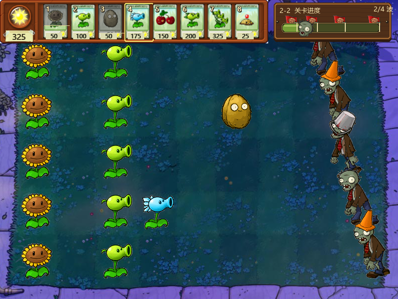
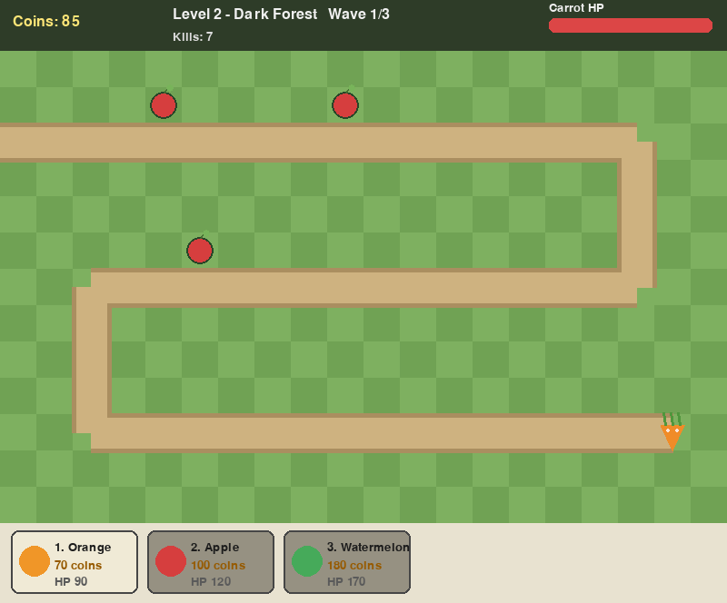

# 双塔防小游戏 · OODT Mini Games

两个独立运行的 Python / pygame 面向对象课程项目，也提供 Windows 64 位免安装版。

| 游戏 | 内容 |
| --- | --- |
| 植物大战僵尸 | 7 个关卡、9 种植物、3 种僵尸；昼夜场景、选卡、选关、逐关解锁与进度保存 |
| 保卫萝卜 / 保卫水果 | 2 个连续关卡、3 种水果防御塔、4 种怪物；金币、生命值与击杀统计 |

## 下载即玩

打开 [Releases 下载页](https://github.com/wlc221222-creator/oodt-mini-games/releases/latest)：

- **两个游戏一起下载**：`oodt-mini-games-windows-x64.zip`。
- **只下载植物大战僵尸**：`plants-vs-zombies-windows-x64.zip`。
- **只下载保卫萝卜**：`defend-carrot-windows-x64.zip`。
- **源码压缩包**：`oodt-mini-games-source.zip`，或点击仓库的 Code → Download ZIP。

Windows 10/11 64 位：解压后双击对应 `.exe`；不需要安装 Python、pygame 或其他运行库。发布包不包含个人存档，新玩家从 1-1 和两种基础植物开始。

植物大战僵尸 EXE 版的存档位置：

```text
%LOCALAPPDATA%\OODTMiniGames\PlantsVsZombies\savegame.json
```

源码运行时，存档保存在 `plants_vs_zombies/savegame.json`。进度逐关保存，通关奖励依次解锁；冒险通关后可在地图重玩已解锁关卡。

## 操作

### 植物大战僵尸

- 主菜单：点击冒险模式继续闯关，或点击选择关卡打开地图。
- 选卡：点击植物加入阵容，点击已选卡片移除；`A` 快速选满，`Enter` 开始。
- 战斗：`1`–`8` 选择卡片；左键种植或收集阳光；右键取消选择。
- 通关：点击“下一关”或按 `Enter` 继续；`R` 重试当前关卡。
- `F` 切换全屏；`Esc` 退出全屏 / 返回庭院，主菜单按 `Esc` 退出。

### 保卫萝卜 / 保卫水果

- `1`–`3` 选择防御水果，左键在空草地建造；路径和萝卜位置不能建造。
- 右键取消选择；胜负界面点击或按 `R` 重新开始；`Esc` 退出。
- 第一关结束后自动进入第二关。

## 截图

截图展示不同解锁阶段，发布包不附带这些测试进度。





## 从源码运行

需要 Python 3.12，以及 `requirements.txt` 中的依赖。

```bash
python -m pip install -r requirements.txt
python plants_vs_zombies/main.py
python defend_carrot/main.py
```

两个游戏使用各自的 `config.py`、`entities.py` 和 `Game` 控制器；从各自入口独立运行。

## 验证

```bash
python plants_vs_zombies/tests/test_adventure_flow.py
python plants_vs_zombies/tests/test_ui_flow.py
python plants_vs_zombies/tests/test_progress.py
python plants_vs_zombies/tests/test_packaged_save.py
python defend_carrot/tests/test_smoke.py
```

完整植物大战僵尸战斗测试可通过 `python tools/test_source.py` 运行，测试存档隔离在临时目录中。

## 自行生成 Windows EXE

在 Windows 64 位 Python 3.12 环境中：

```bash
python -m pip install -r requirements-build.txt
python tools/build_windows.py
```

构建输出为 `dist/PlantsVsZombies.exe` 和 `dist/DefendCarrot.exe`。构建脚本会运行实际 EXE 自检，确认素材加载、初始关卡、种植/建造和渲染可用。

## 面向对象结构

- `Entity` 抽象基类：统一更新与绘制接口。
- 具体植物 / 水果 / 怪物类：封装各自行为，用继承和多态组织对象。
- `Game`：协调实体、输入、经济、关卡与胜负状态。
- 植物大战僵尸的 `assets.py` 与 `garden_ui.py`：集中管理素材与界面表现。

## 素材来源

植物大战僵尸图片来自参考项目 [marblexu/PythonPlantsVsZombies](https://github.com/marblexu/PythonPlantsVsZombies) 中的素材包，相关角色与美术归原权利人。此仓库用于课程学习与非商业演示；第三方素材的权利和来源说明见 [THIRD_PARTY_NOTICES.md](THIRD_PARTY_NOTICES.md)。保卫萝卜项目的画面由程序绘制。
