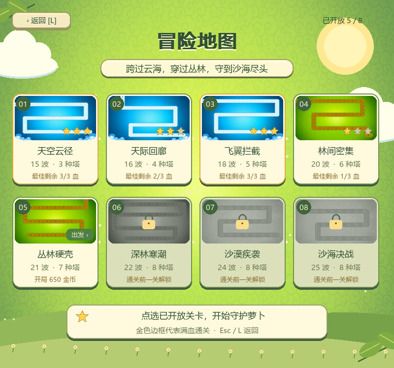
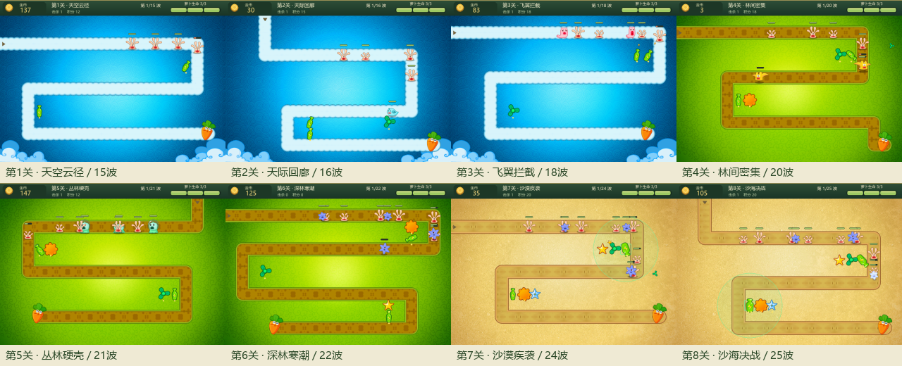
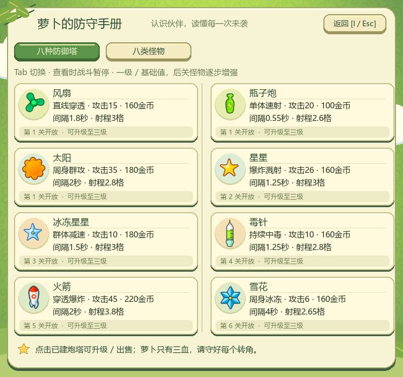
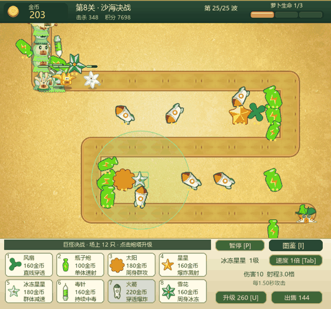

# 双塔防小游戏 · OODT Mini Games

两个独立运行的 Python / pygame 面向对象课程项目，也提供 Windows 64 位免安装版。

| 游戏 | 内容 |
| --- | --- |
| 植物大战僵尸 | 14 个关卡、16 种植物、5 种僵尸；昼夜场景、选卡、选关、逐关解锁与进度保存 |
| 保卫萝卜 | 8 关、8 种三级炮塔、8 类怪物；三大主题、逐关塔池、原版动画、解锁保存 |

## 下载即玩

打开 [Releases 下载页](https://github.com/wlc221222-creator/oodt-mini-games/releases/latest)：

- **两个游戏一起下载**：`oodt-mini-games-windows-x64.zip`。
- **只下载植物大战僵尸**：`plants-vs-zombies-windows-x64.zip`。
- **只下载保卫萝卜**：`defend-carrot-windows-x64.zip`。
- **源码压缩包**：`oodt-mini-games-source.zip`，或点击仓库的 Code → Download ZIP。

Windows 10/11 64 位：解压后双击对应 `.exe`；不需要安装 Python、pygame 或其他运行库。发布包不包含个人存档，新玩家从 1-1 和两种基础植物开始。

植物大战僵尸 EXE 版的存档位置：

```text
%LOCALAPPDATA%\OODTMiniGames\PlantsVsZombies\savegame.json
```

源码运行时，存档保存在 `plants_vs_zombies/savegame.json`。进度逐关保存，通关奖励依次解锁；冒险通关后可在地图重玩已解锁关卡。

## 操作

### 植物大战僵尸

- 主菜单点击“植物与僵尸图鉴”，或在任意界面按 `I` 查看全部 16 种植物和 5 种僵尸的介绍。`Tab` 切换分类，`←` / `→` 翻页，`I` / `Esc` 或返回按钮关闭；查看时战斗暂停，关闭后继续。未解锁植物可查看介绍，仍需冒险通关获得。
- 主菜单：点击冒险模式继续闯关，或点击选择关卡打开地图。
- 选卡：点击植物加入阵容，点击已选卡片移除；`A` 快速选满，`Enter` 开始。
- 战斗：按住上方植物卡片，拖到草坪有效格子松手种植；植物贴图随鼠标移动。无效位置松手、右键或拖动时按 `Esc` 都会取消，不扣阳光、不触发冷却；冷却、价格和占格规则保持不变。保留 `1`–`8` 选卡后点击草坪的快捷操作；阳光仍用左键点击收集。
- 铲子：按住右上角铲子，拖到植物所在格子松手，只铲除该株植物，不返还阳光、不重置卡片冷却。每次使用后回到工具栏；空地或草坪外松手取消。铲子从第一关起可用。
- 暂停、打开图鉴、切关、窗口缩放或失去焦点会取消当前拖动，恢复后不会自动种植或铲除。五行草坪全部可种，拖动时显示格子和目标提示。
- 战斗中按 `P` 或点击右下角暂停按钮，暂停阳光、冷却和敌人行动；`P` / `Enter` / `Esc` 或“继续战斗”恢复。暂停时可按 `I` 查看图鉴，返回后仍保持暂停。
- 通关：点击“下一关”或按 `Enter` 继续；`R` 重试当前关卡。
- `F` 切换全屏；`Esc` 退出全屏 / 返回庭院，主菜单按 `Esc` 退出。

前七关分别为：五路初战、两翼夹击、极速突袭、重甲攻坚、阳光补给、无光之夜、月下决战。
选卡页显示本关规则；战斗中显示波次名称、清波后的倒计时和即将来袭的行。
极速突袭的僵尸移速提高 30%；补给关清波获得阳光；夜间关卡不再掉落天降阳光，需要向日葵维持经济。
原有存档、植物奖励和逐关解锁顺序保持兼容。

夜战扩展新增 2-3 至 2-9 七关，小喷菇、阳光菇、胆小菇、大嘴花、窝瓜、地刺、寒冰菇，以及旗帜僵尸和读报僵尸。
地图与种子册均支持左右按钮或 `←` / `→` 翻页；鼠标停在种子卡上查看能力。
新增植物仍通过冒险通关解锁，寒冰菇在 2-9 后解锁，可重玩夜间关卡试用。
旧七关已通关的存档加载后可直接继续 2-3。各品种机制、数值缩放和解锁顺序见 [夜战扩展说明](plants_vs_zombies/EXPANSION.md)。

### 保卫萝卜

- 共8关，按天际、丛林、沙漠推进；每关15～25波，怪物总数从96递增到366，可用炮塔从3种增至8种。开局资金、怪物生命与速度逐步提高，后关需要更多布防与升级。逐关表格与参考依据见 [八关扩展说明](defend_carrot/EXPANSION.md)。
- 主菜单按 `Enter` 继续最新开放关卡，`L` 选择已开放关卡重玩。通关后按 `Enter` 前进；失败按 `R` / `Enter` 重试当前关。每关使用自己的开局金币，上一关金币不带入；积分与击杀在连续挑战中累计。
- `1`～`8` 或点击卡片选择防御塔，左键空地建造、右键取消。未开放的卡片标明开放关卡；路径、萝卜位置和已有塔的格子不能建造。
- 点击已建炮塔查看射程和属性；`U` 或按钮升级，最高三级；`Delete` 或按钮出售，返还建造及升级总投入的80%。升级使用对应级别的原版图像与动作。
- 瓶子炮单体速射、风扇直线穿透、太阳周身群攻；后续增加星星溅射、冰冻星星减速、毒针持续毒伤、火箭穿透爆炸、雪花周身冰冻。怪物包含普通、飞行、厚血精英和末波巨怪，均使用原版序列帧。
- 萝卜始终只有 **3 血**，每只漏怪扣 **1 血**，第三只漏怪立即失败。3血、2血、1血分别展示完整、受损、濒危的原版造型；进入下一关恢复3血。
- `Tab` / 速度按钮切换1倍、2倍速；`P` 暂停。`I` 打开图鉴，图鉴内 `Tab` 切换炮塔/怪物；暂停和图鉴冻结战斗计时、状态效果及战斗动画。`Esc` 暂停或返回菜单，主菜单 `Esc` 退出。
- 关卡解锁及最佳剩余生命自动写入 `defend_carrot/progress.json`，重启可继续选择；正在进行的战斗不保存。EXE版存于 `%LOCALAPPDATA%/OODTMiniGames/DefendCarrot/progress.json`。与植物大战僵尸存档独立，发布代码不包含个人进度。
- 地图道路连续绘制并使用原版纹理，转角保持完整；角色采用放大后的显示尺寸。来源与旧素材说明见 [美术资源说明](defend_carrot/assets/ART_NOTES.md) 和 [第三方素材声明](THIRD_PARTY_NOTICES.md)。
- 主菜单使用原版天空背景与角色，加入眨眼、怪物动作、漂浮光点和炮塔展示。冒险地图显示八关真实路线预览、解锁锁扣与最佳血量星标；左上角按钮或 `Esc` / `L` 返回。图鉴采用手册卡片，暂停与结算显示绶带、萝卜状态及成绩；按钮有悬停、按下和不可升级提示。界面动效独立于战斗计时。

## 截图

截图展示不同解锁阶段，发布包不附带这些测试进度。









## 从源码运行

需要 Python 3.12 或更高版本，以及 `requirements.txt` 中的依赖。Python 3.14
会自动安装提供相同 `pygame` 导入模块的 `pygame-ce`，避免从源码编译旧版
pygame；Python 3.12/3.13 使用 pygame 2.6.1。

```bash
python -m pip install -r requirements.txt
python plants_vs_zombies/main.py
python defend_carrot/main.py
```

两个游戏使用各自的 `config.py`、`entities.py` 和 `Game` 控制器；从各自入口独立运行。

## 验证

```bash
python plants_vs_zombies/tests/test_adventure_flow.py
python plants_vs_zombies/tests/test_ui_flow.py
python plants_vs_zombies/tests/test_pause.py
python plants_vs_zombies/tests/test_drag_tools.py
python plants_vs_zombies/tests/test_hit_flash.py
python plants_vs_zombies/tests/test_progress.py
python plants_vs_zombies/tests/test_packaged_save.py
python plants_vs_zombies/tests/test_gameplay_revision.py
python plants_vs_zombies/tests/test_level_balance.py
python plants_vs_zombies/tests/test_expansion.py
python defend_carrot/tests/test_smoke.py
python defend_carrot/tests/test_rules.py
python defend_carrot/tests/test_ui_flow.py
python defend_carrot/tests/test_presentation.py
python defend_carrot/tests/test_placement.py
```

两个游戏的完整回归测试可通过 `python tools/test_source.py` 运行，测试存档隔离在临时目录中。

## 自行生成 Windows EXE

在 Windows 64 位 Python 3.12 环境中：

```bash
python -m pip install -r requirements-build.txt
python tools/build_windows.py
```

构建输出为 `dist/PlantsVsZombies.exe` 和 `dist/DefendCarrot.exe`。构建脚本会收集两个游戏各自的素材目录，并运行实际 EXE 自检，确认素材加载、初始关卡、种植/建造和渲染可用。

## 面向对象结构

- `Entity` 抽象基类：统一更新与绘制接口。
- 具体植物 / 水果 / 怪物类：封装各自行为，用继承和多态组织对象。
- `Game`：协调实体、输入、经济、关卡与胜负状态。
- 植物大战僵尸的 `assets.py` 与 `garden_ui.py`：集中管理素材与界面表现。
- 保卫萝卜的 `ui.py`、`guide.py` 与 `presentation.py`：管理菜单、图鉴、场景装饰和通用控件；界面时钟与战斗模拟独立。

## 素材来源

植物大战僵尸图片来自参考项目 [marblexu/PythonPlantsVsZombies](https://github.com/marblexu/PythonPlantsVsZombies) 中的素材包，相关角色与美术归原权利人。此仓库用于课程学习与非商业演示；第三方素材的权利和来源说明见 [THIRD_PARTY_NOTICES.md](THIRD_PARTY_NOTICES.md)。保卫萝卜使用第三方镜像保留的原版角色与场景素材，道路按本项目八张路线绘制；玩法参考原作，三血制和关卡数值为课程项目设计。
